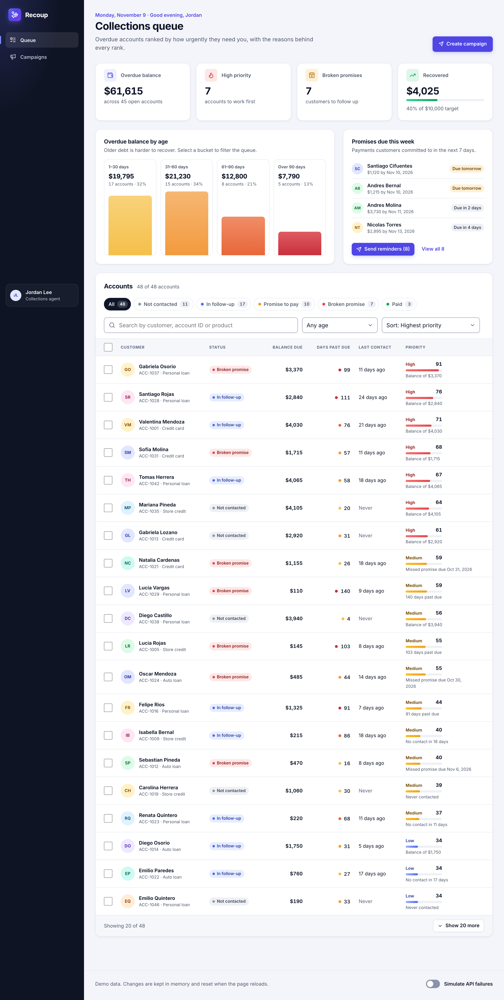
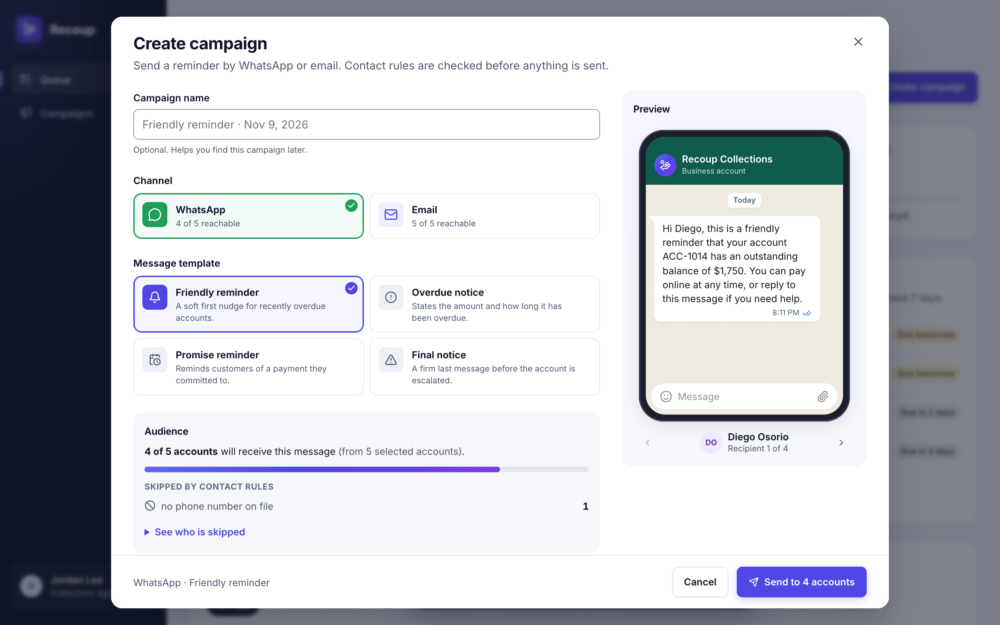
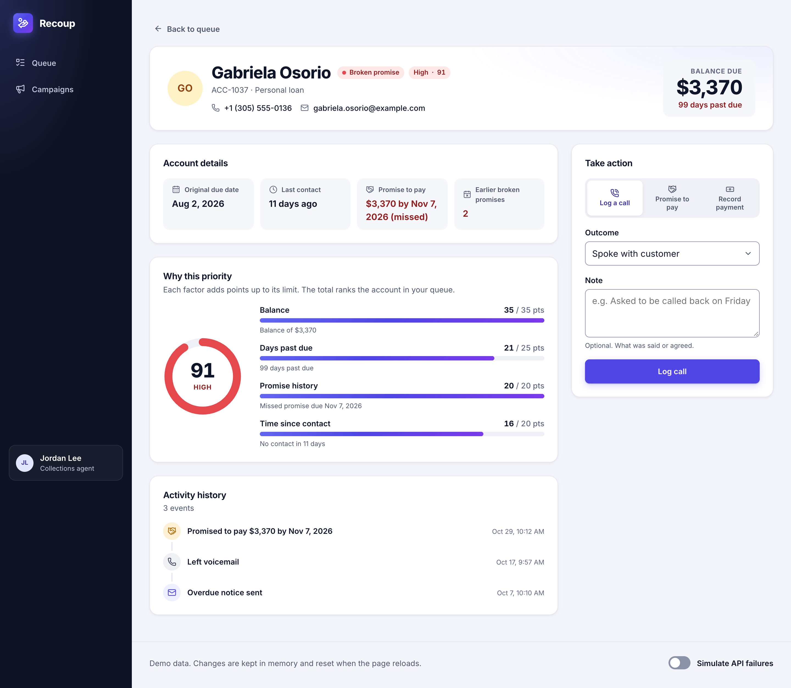

# Recoup — a collections workspace

Recoup helps a debt collector decide **which overdue accounts to work first**, act on them, and send payment reminders by WhatsApp or email without contacting people who should not be contacted.

It is a frontend-only React application. The backend is simulated in memory.

## Run it

Requires Node 20.19+ or 22.13+ (the minimum that Vite and jsdom both support).

```bash
npm install
npm run dev        # http://localhost:5173
```

| Command | What it does |
| --- | --- |
| `npm run dev` | Start the development server |
| `npm test` | Run unit and integration tests once |
| `npm run test:watch` | Run tests in watch mode |
| `npm run typecheck` | Type-check the project |
| `npm run lint` | Lint with Oxlint |
| `npm run build` | Type-check and build for production |

**To see the error states:** turn on **Simulate API failures** in the page footer. Every request fails while it is on. Reload the page to see a failed first load, or navigate between screens to see a failed refresh that keeps the previous data on screen.

Data resets when the page reloads.

## The problem

A collector at a consumer lender is assigned a portfolio of overdue accounts and has more of them than they can contact in a day. Their day is a series of small decisions:

- Who do I contact first?
- Has this person already promised to pay, and did they keep that promise?
- Who can I reach with one bulk reminder instead of forty phone calls?
- Who must I *not* contact, because we spoke yesterday or because they already committed to a date?

Most tools answer this with a sortable table of debtors. That leaves the prioritising to the collector, and it makes it easy to send a reminder to someone who promised to pay on Friday.

## The user

**A collections agent** working a personal portfolio of a few dozen to a few hundred overdue consumer accounts (loans, credit cards, store credit). They are at a desk for most of the day, are measured on money recovered, and are not technical. They need to trust the order of the queue, so the app always says *why* an account is ranked where it is.

## What it does

| Requirement | Where it lives |
| --- | --- |
| Primary workspace | **Collections queue**: headline numbers, an aging chart, the promises due this week, and the accounts ranked by a priority score |
| Meaningful data | 48 generated accounts with balances, due dates, promises, contact history and two past campaigns |
| Explore the data | Search, status chips with live counts, an age filter, five sort orders, and an aging chart whose columns are also filters |
| Detail view | **Account page**: contact details, key facts, a visual breakdown of the priority score, and the activity history |
| Actions that change state | Log a call, register a promise to pay (with one-tap amount and date shortcuts), record a payment, send a campaign with a live WhatsApp or email preview |
| Loading, empty, error | Skeletons, a "no accounts match" state with a way out, error states with retry, and a stale-data warning |
| Responsive | Works from 320px wide: the table drops secondary columns, dialogs become full-screen sheets |
| Accessibility | See [Accessibility](#accessibility) |



| Campaign composer | Account page |
| --- | --- |
|  |  |

Every screen, on desktop and phone, is in [screenshots/](screenshots/).

Two pieces of domain logic carry most of the value:

- **Priority score** ([src/domain/priority.ts](src/domain/priority.ts)). A transparent weighted sum of balance, days past due, broken promises and time since last contact. It returns the score, its reasons strongest first, and the points each factor contributed, which the account page draws as a breakdown.
- **Contact rules** ([src/domain/eligibility.ts](src/domain/eligibility.ts)). Before a campaign is sent, each account is checked: paid accounts, customers with no phone or email for the chosen channel, customers with a live promise to pay, and anyone contacted in the last three days are skipped. The composer shows who is skipped and why before anything is sent.

## Architecture

```
src/
  domain/      Pure TypeScript. Types and business rules. No React, no I/O.
  api/         The simulated backend: in-memory data, latency, failures.
  queries/     React Query hooks. The only place the UI touches the API.
  features/    One folder per screen, with the components only that screen uses.
    portfolio/   The queue
    account/     The account detail page
    campaigns/   The campaign composer and campaign history
    shared/      Domain-aware components used by several features
  components/  Generic UI primitives: Button, Badge, Avatar, Card, Dialog, Field,
               PageHeader, SegmentedControl, toasts, and loading/empty/error views.
  hooks/       Small app-wide hooks (the current date, the current user).
  lib/         Framework-free helpers.
  styles/      Design tokens and global styles.
  app/         Composition root: providers, routes, layout.
```

Dependencies point one way: `features → queries → api → domain`, and `components` knows nothing about the domain. In practice that means:

- The business rules can be read, tested and changed without rendering anything.
- Replacing the simulated API with a real one touches `src/api` only. The function signatures already look like HTTP calls, and they return copies of the data so the UI cannot mutate "server" state by reference.
- A feature can be deleted by deleting its folder and its route.

### How data flows

1. A screen calls a hook from `src/queries`, for example `useAccounts()`.
2. The hook fetches raw accounts from `src/api` and caches them with React Query.
3. In the query's `select`, each account is enriched with **derived insights** (status, aging bucket, days past due, priority). These are computed, never stored, so they cannot drift out of sync with the data.
4. The screen filters and sorts that list with pure functions, memoised on their inputs.
5. A mutation (say, registering a promise) calls the API, writes the returned account into the detail cache and invalidates the list, so the queue re-ranks itself.

### Where state lives

I picked the home of each piece of state by what kind of state it is:

| State | Home | Why |
| --- | --- | --- |
| Accounts, campaigns | React Query cache | It is server state: it needs caching, loading and error tracking, and invalidation |
| Search, filters, sort | The URL | A filtered view is shareable, survives opening an account and coming back, and works with the back button |
| Row selection, rows shown, open dialog, form fields | `useState` in the nearest component | Transient UI state that nothing else needs |
| Confirmation messages | A toast context | Any action can confirm itself without knowing where messages are shown |
| Status, priority, aging | Nowhere | Derived from the data on read |

There is no global client store because nothing in the app needs one yet.

## Key technical decisions

**Derive, don't store.** An account's status is not a field. A promise becomes "broken" because its date has passed, not because something remembered to update a record. This removes a whole class of stale-state bugs and keeps the server model small.

**The same rule runs on both sides.** The composer previews who will be skipped using `splitByEligibility`. The simulated server runs the same function again when the campaign is sent and is the one that decides. The client preview is a convenience, not the enforcement point.

**An explainable score over a clever one.** The priority is a weighted sum with named constants, and every score ships with its reasons. A collector can disagree with it, and an engineer can tune it in one file.

**Dates are an argument, not a global.** Domain functions take `today` as a parameter instead of calling `new Date()`. They stay pure, and tests use a fixed date. Date-only strings are parsed as local calendar days to avoid the classic "off by one day west of UTC" bug.

**A chart without a chart library.** The aging chart is four buttons with CSS columns, and the priority ring is a single SVG circle. Every value is real text, each column is keyboard-operable and acts as a filter, and neither adds anything to the bundle.

**The UI is built around the collector's next decision.** The queue opens on the top 20 accounts, because that is the work for today, with "Show more" for the rest. Customers with a promise due this week rank low in the queue on purpose (they should not be chased), so they get their own panel with a one-click reminder campaign. The composer shows the exact message each customer will receive before anything is sent.

**One design system, in tokens.** Colours, spacing, radii and shadows are CSS custom properties in [src/styles/tokens.css](src/styles/tokens.css), and every text and background pair in them was checked against WCAG AA.

**Native `<dialog>` for the modal.** `showModal()` provides focus trapping, an inert background, Escape to close and focus restoration, so there is no focus-trap dependency.

**Generated seed data.** Accounts are generated from a seeded random generator with dates relative to today. The queue always has promises due this week and accounts inside the cooldown, whenever the app is opened, and the data is identical on every load.

## Libraries, and why

| Library | Why I chose it | What I considered instead |
| --- | --- | --- |
| **Vite** | Fast, minimal, the default for a client-only React app | Next.js: no need for a server, routing conventions or SSR here |
| **TypeScript** | The domain has many small states (`promise_active`, `recently_contacted`…). Union types make the compiler check that every one is handled | — |
| **TanStack Query** | Loading, error, caching, refetch and invalidation for server state, without hand-written reducers | `useEffect` + `useState`: fine for one request, but it would reimplement caching and invalidation badly. Redux Toolkit: more ceremony than this app needs |
| **React Router** | URL-backed filters and a real detail route | Hand-rolled state: loses deep links and the back button |
| **CSS Modules + custom properties** | Scoped styles with zero runtime, and design tokens in one file | Tailwind: quicker to write, noisier to review. A component library: would hide the component and accessibility work this exercise asks to see |
| **Vitest + Testing Library** | Shares Vite's config. Tests query by role and label, the way a user finds things | Jest: needs separate transform setup |
| **axe-core** | Automated accessibility checks inside the integration tests | — |
| **Oxlint** | Ships with the Vite template; fast enough to run on every save | ESLint |
| **Lucide** (`lucide-react`) | Consistent, tree-shaken SVG icons: only the icons used end up in the bundle | Hand-drawn SVGs: slower to make and harder to keep consistent |
| **Inter** (`@fontsource-variable/inter`) | A typeface designed for dense interfaces, with tabular numbers for money columns. Bundled, so it works offline and without a third-party request | Google Fonts: an extra request to another domain. System fonts: fine, but less consistent across platforms |

There are six runtime dependencies: React, React DOM, React Router, TanStack Query, Lucide and the Inter font.

## Testing

```bash
npm test
```

- **Unit tests** cover the business rules: priority scoring, contact rules, status and aging boundaries, template rendering, and filter parsing, searching and sorting. These are where a mistake would cost real money or contact the wrong person, so they get the most cases.
- **Integration tests** render the real app (routes, layout, data layer) with only network latency removed, and drive it like a user: search, filter with the status chips and the chart, reveal more rows, hit the empty state, fail and retry a load, select accounts across searches and send a campaign, open reminders from the promises panel, fail form validation, use the promise shortcuts, record a payment.
- **Accessibility checks** run axe-core against the queue and the account page.

Writing the tests caught two real bugs: the URL status filter was validated with the `in` operator, which also accepts inherited keys like `constructor`; and several controls built from separate text spans had accessible names with no space between words ("Broken promise7"), which a screen reader would read as one word.

What the tests do not cover: visual layout, focus trapping inside the modal (jsdom does not implement `<dialog>`, so tests use a small stand-in), and real browsers. Those were checked in Chrome at desktop and phone widths, down to 320px, with a scripted browser run that is not part of this repository.

## Accessibility

- Semantic landmarks, one `h1` per page, a skip link, and a real `<table>` with a caption and row headers that stays a table on small screens.
- Everything works with the keyboard. Custom-looking controls (segmented control, channel and template cards, chart columns, status chips, the failure toggle) are native radios, buttons and a `role="switch"` checkbox underneath.
- Focus moves to the main region on navigation, into the dialog when it opens, back to the trigger when it closes, to the confirmation after a campaign is sent, and to the first invalid field after a failed submit.
- Form errors are tied to their fields with `aria-describedby` and `aria-invalid`. The `Field` component owns that wiring so a form cannot forget it.
- Result counts, the selection count, the campaign audience and toast confirmations are announced through live regions. Toasts never take focus away from what the collector is doing.
- Icons are decorative and hidden from screen readers; the text next to them carries the meaning.
- Colour is never the only signal: every badge has a text label. All text and background pairs in the design tokens meet WCAG AA contrast.
- `prefers-reduced-motion` is respected. Buttons and inputs are at least 36px tall, and checkboxes meet the WCAG 2.2 minimum target size of 24px.

Not done: testing with a real screen reader. I would do that before calling this accessible.

## Performance

- The priority and status of every account are computed once per data change in React Query's `select`, not on every render.
- Filtering and sorting are memoised, and the search term goes through `useDeferredValue` so typing is never blocked.
- Table rows are wrapped in `memo` and receive stable props, so ticking a checkbox re-renders one row.
- The queue renders 20 rows at a time; "Show more" adds the next 20.
- The account and campaign screens are code-split and load on demand.

With 48 rows none of this is needed for speed. I kept it because it is cheap and shows where the costs would be. At a few thousand rows the next step is server-side pagination, then row virtualisation.

## Assumptions and tradeoffs

- **No backend.** Data lives in memory and resets on reload. Message sending and delivery results (delivered, read, replied) are simulated with random outcomes.
- **Any contact attempt starts the cooldown**, including an unanswered call. A real policy would likely distinguish attempts from conversations.
- **Payments are all-or-nothing.** Partial payments would need a ledger, which is a different feature.
- **One collector, no authentication.** The signed-in collector ("Jordan Lee") is a fixed demo user behind a `useCurrentUser` hook. There is no assignment, permissions or audit trail.
- **The recovery target is a demo constant** ($10,000), not a real goal from data.
- **Single currency and locale** (USD, `en-US`), formatted with `Intl` in one file.
- **The priority weights are my judgment**, not fitted to data. They are named constants so they are easy to challenge.
- **Selection survives filter changes.** Selected rows stay selected when filtered out of view. The toolbar always shows the count, but an explicit "show selected" view would be clearer.
- **No retries.** I turned off React Query's retries because the simulated API fails deterministically and retries would only delay the error state. Against a real API I would keep retries for queries.
- **"Today" is read once per screen.** A tab left open past midnight shows yesterday's ranking until it is reloaded.
- **Light theme only.**

## What I would build next

1. **Scheduled, rule-based reminders** ("three days before a promise is due, send the promise reminder"). This is the natural next feature and the one I deliberately cut: it needs a rules model, a scheduler and an audit log, and would not fit the time limit without lowering the quality of everything else.
2. **Optimistic updates** for logging a call, with rollback on failure. Today the UI waits for the response.
3. **End-to-end tests** in a real browser (Playwright) for the campaign flow, including focus trapping in the dialog.
4. **Undo** for recording a payment, instead of a confirmation step.
5. **A campaign detail page** with replies, and a way to turn a reply into a promise to pay.
6. **Screen reader testing** and a dark theme built on the existing tokens.

## What I would refactor

- `AccountActions.tsx` holds three forms in one file. I would split them and extract a small form hook once a fourth action appears.
- `PortfolioPage` owns filtering, selection, how many rows are shown and the composer. I would move selection and paging into small hooks so they can be tested alone.
- The seed generator is the least readable file in the project. With a real API it disappears; otherwise I would replace it with a library like Faker and a fixed seed.

## If the app grew much larger

- Generate the API types and client from an OpenAPI schema, and mock the network with MSW so tests and development hit the same contract.
- Move search, filtering, sorting and pagination to the server. The URL-backed filter state already maps directly onto query parameters.
- Turn `components/` into a documented design system with visual regression tests.
- Enforce the dependency direction between layers with lint rules, and give each feature a public entry point.
- Add error monitoring, feature flags and analytics on the actions that matter (promises created, campaigns sent, payments recorded).
- Add roles and permissions: collectors see their portfolio, supervisors see the team's.

## Deploying

The build is a static site (`npm run build` → `dist/`). Because it uses client-side routing, the host must serve `index.html` for unknown paths. `vercel.json` and `public/_redirects` already configure that for Vercel and Netlify.
